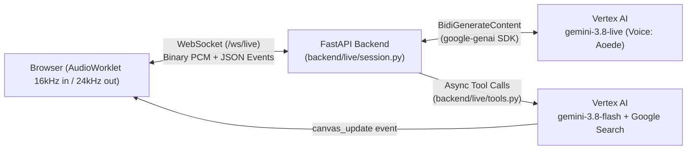

# Gemini 3.8 Live Scaffold

A clean, reusable full-screen web boilerplate for building real-time conversational AI applications powered by **Gemini 3.8 Live** (`gemini-3.8-live`) on Google Cloud Vertex AI.

Out of the box, this scaffold provides:
- **Minimalist Entry Page**: A distraction-free landing view with a single button (**Buka Asisten AI**) to launch the assistant.
- **Full-Screen 2-Panel Workspace**:
  - **Left Panel (Transkrip Percakapan)**: Real-time streaming transcription for both user speech (`input_audio_transcription`) and AI speech (`output_audio_transcription`), live mic level indicator, mute/unmute controls, and optional text input.
  - **Right Panel (Halaman Dinamis / Dynamic Canvas)**: Starts with a warm Bahasa Indonesia greeting page and dynamically updates with grounded Google Search results (summary + clickable source links) or structured discussion cards triggered by the conversation.
- **Natural Bahasa Indonesia Voice (`Aoede`) & Barge-in**: Full-duplex 16kHz PCM mic capture + 24kHz PCM playback with echo cancellation and instant AudioWorklet buffer flushing whenever the user interrupts the assistant.
- **Modular, Reusable Architecture**: Clean separation between config, prompts, Gemini Live session bridge, extensible tool flows, and frontend audio/UI modules.

---

## Architecture



---

## Folder Structure

```text
gemini-3.8-flash-live-sca-scaffold/
├── README.md                               # This guide
├── pyproject.toml                          # Python dependencies (uv / pip)
├── .env.example                            # Environment variable template
├── Dockerfile                              # Cloud Run production container
├── deploy.sh                               # One-command public Cloud Run deploy script
├── backend/
│   ├── main.py                             # FastAPI entrypoint & static frontend mount
│   ├── api/
│   │   └── routes.py                       # /api/health, /api/config, and /ws/live
│   ├── config/
│   │   ├── settings.py                     # Centralized model, voice, region & audio config
│   │   └── prompts.py                      # Assistant persona, greeting prompt & ASR vocab
│   └── live/
│       ├── session.py                      # Gemini 3.8 Live WebSocket bridge & barge-in handler
│       └── tools.py                        # Extensible tool registry (search_web, update_canvas, etc.)
└── frontend/
    ├── index.html                          # Minimal landing page + full-screen 2-panel workspace
    ├── css/
    │   └── styles.css                      # Clean responsive Vanilla CSS styling
    └── js/
        ├── app.js                          # Main UI & session lifecycle controller
        ├── audio/
        │   ├── audio-manager.js            # Mic capture (echoCancellation) & playback manager
        │   ├── pcm-recorder.worklet.js     # Downsamples mic to 16kHz 16-bit PCM mono
        │   └── pcm-player.worklet.js       # 24kHz PCM ring buffer with instant barge-in clear
        ├── live/
        │   └── live-client.js              # WebSocket client + heartbeat
        └── ui/
            ├── transcript-panel.js         # Left panel: real-time user & AI transcripts
            └── canvas-panel.js             # Right panel: dynamic welcome, search & card views
```

---

## Quick Start — Local Development & Testing

### Prerequisites
- Python **3.11+** and [`uv`](https://docs.astral.sh/uv/) (or `pip`)
- Google Cloud CLI (`gcloud`) with access to a GCP project where **Vertex AI API** (`aiplatform.googleapis.com`) is enabled

### 1. Authenticate with Google Cloud (ADC)
```bash
gcloud auth application-default login
gcloud config set project YOUR_PROJECT_ID
```

### 2. Configure Environment Variables
```bash
cp .env.example .env
```
Edit `.env` and set your `GOOGLE_CLOUD_PROJECT` (and optionally `GOOGLE_CLOUD_LOCATION`, `GEMINI_VOICE_NAME`, etc.).

> **Alternative (Gemini Developer API Key):** If you prefer using an API key instead of Vertex AI ADC, set `GOOGLE_GENAI_USE_VERTEXAI=false` and `GEMINI_API_KEY=your-key` in `.env`.

### 3. Install Dependencies & Run Locally
```bash
uv sync
uv run uvicorn backend.main:app --host 0.0.0.0 --port 8080 --reload
```
Open **http://localhost:8080** in Chrome, Edge, or Safari, click **Buka Asisten AI**, grant microphone access, and start talking in Bahasa Indonesia!

> **Note on Microphone Permissions:** Browsers only allow `getUserMedia()` on `http://localhost` or `https://` origins. When deployed to Cloud Run, HTTPS is provided automatically.

---

## Customization Guide (Where & What to Edit)

This repository is designed as a reusable scaffold. Here is exactly where to make changes for your own use case:

### 1. Assistant Persona, Language & Initial Greeting
**File:** [`backend/config/prompts.py`](backend/config/prompts.py)
- **`SYSTEM_INSTRUCTION`**: Edit the tone, domain expertise, guardrails, language rules, and instructions on when to trigger tools or update the right panel.
- **`INITIAL_GREETING_PROMPT`**: Edit what the assistant says automatically the moment a user opens the session.
- **`CUSTOM_VOCABULARY`**: Add brand names, product SKUs, or Indonesian/domain acronyms here. Gemini 3.8 Live passes these directly into `input_audio_transcription.custom_vocabulary` to improve speech recognition accuracy.

### 2. Gemini 3.8 Live Settings (Model, Voice, Region, Audio)
**Files:** [`backend/config/settings.py`](backend/config/settings.py) and [`backend/live/session.py`](backend/live/session.py)
- **Model ID**: `GEMINI_LIVE_MODEL` defaults to `gemini-3.8-live`.
- **Voice**: `GEMINI_VOICE_NAME` defaults to `Aoede`. You can switch to any of the 30 prebuilt HD voices (e.g., `Kore`, `Puck`, `Charon`, `Fenrir`, `Leda`) via `.env` or Cloud Run env vars.
- **Vertex AI Region**: `GOOGLE_CLOUD_LOCATION` supports `us-central1`, `asia-south1`, `us`, or `eu` for `gemini-3.8-live`.
- **Advanced Live API Options**: In `build_live_config()` inside [`backend/live/session.py`](backend/live/session.py), you can tune:
  - `context_window_compression`: Enabled by default so sessions last beyond 15 minutes.
  - `realtime_input_config`: Tune Voice Activity Detection (VAD) sensitivity if deploying in noisy environments.
  - Note: Affective dialogue and proactive audio are enabled by default in `gemini-3.8-live`.

### 3. Adding New Business Logic & Conversation Flows (Tools)
**File:** [`backend/live/tools.py`](backend/live/tools.py)

To add a new flow (e.g., checking order status, booking a meeting, querying BigQuery/Firestore, or calling an internal API):
1. **Declare the tool** inside `get_tool_declarations()` using `types.FunctionDeclaration`. Keep `behavior=types.Behavior.NON_BLOCKING` so Gemini 3.8 Live can speak an acknowledgment smoothly while your backend runs.
2. **Implement the async handler** on `ToolExecutor` (e.g., `async def _handle_check_order(self, args)`).
3. **Register it** in `self._handlers` inside `ToolExecutor.__init__`.
4. **Update the Right Panel** (optional): Call `await self._emit_canvas({...})` inside your handler to render live visual data for the user.
5. **Mention the tool** in `SYSTEM_INSTRUCTION` ([`backend/config/prompts.py`](backend/config/prompts.py)) so the assistant knows when to invoke it.

### 4. Customizing the Right Panel (Dynamic Canvas)
**File:** [`frontend/js/ui/canvas-panel.js`](frontend/js/ui/canvas-panel.js)
- Currently supports four modes: `welcome`, `loading`, `search`, and `structured`.
- Add a new `case "my_custom_view":` inside `CanvasPanel.render(payload)` to render custom forms, charts, product catalogs, or interactive widgets whenever your backend tool emits `{"mode": "my_custom_view", ...}`.
- Customize starter suggestion chips in `CanvasPanel.renderWelcome()`.

### 5. Styling & Branding
**Files:** [`frontend/index.html`](frontend/index.html) and [`frontend/css/styles.css`](frontend/css/styles.css)
- Edit CSS custom properties (`--accent`, `--bg-page`, `--font-display`, etc.) at the top of `styles.css` to match your brand palette.

---

## Deploying to Google Cloud Run (Public)

### Prerequisites
1. Enable required APIs on your GCP project:
   ```bash
   gcloud services enable run.googleapis.com cloudbuild.googleapis.com artifactregistry.googleapis.com aiplatform.googleapis.com
   ```
2. Ensure the Cloud Run runtime service account (by default `<PROJECT_NUMBER>-compute@developer.gserviceaccount.com`) has the **Vertex AI User** role (`roles/aiplatform.user`).

### Option A: One-Command Deploy Script
```bash
chmod +x deploy.sh
./deploy.sh YOUR_PROJECT_ID asia-southeast2 us-central1
```

### Option B: Manual `gcloud run deploy`
```bash
gcloud run deploy gemini-38-live-scaffold \
  --source . \
  --project YOUR_PROJECT_ID \
  --region asia-southeast2 \
  --allow-unauthenticated \
  --session-affinity \
  --timeout 3600 \
  --memory 1Gi \
  --cpu 1 \
  --concurrency 40 \
  --set-env-vars "GOOGLE_GENAI_USE_VERTEXAI=true,GOOGLE_CLOUD_PROJECT=YOUR_PROJECT_ID,GOOGLE_CLOUD_LOCATION=us-central1,GOOGLE_CLOUD_SEARCH_LOCATION=global,GEMINI_LIVE_MODEL=gemini-3.8-live,GEMINI_SEARCH_MODEL=gemini-3.8-flash,GEMINI_VOICE_NAME=Aoede,GEMINI_LANGUAGE_CODE=id-ID"
```

Key Cloud Run flags for Gemini Live WebSockets:
- `--allow-unauthenticated`: Makes the web app publicly accessible.
- `--session-affinity`: Keeps WebSocket connections pinned cleanly to the same instance.
- `--timeout 3600`: Allows long-lived WebSocket voice sessions (up to 60 minutes).

---

## Troubleshooting

| Issue | Cause & Fix |
| --- | --- |
| **Microphone permission denied** | Access via `https://` (Cloud Run URL) or `http://localhost:8080`. Plain HTTP on non-localhost IPs blocks `getUserMedia()`. |
| **403 Permission Denied on Vertex AI** | Grant `roles/aiplatform.user` to your Cloud Run service account (or run `gcloud auth application-default login` locally). |
| **Model not found / Unsupported location** | Ensure `GOOGLE_CLOUD_LOCATION` is set to a supported `gemini-3.8-live` region (`us-central1`, `asia-south1`, `us`, or `eu`) and `GOOGLE_CLOUD_SEARCH_LOCATION=global`. |
| **Assistant interrupts itself** | Always test with browser echo cancellation enabled (already configured in `audio-manager.js`) or use headphones in very loud rooms. |
